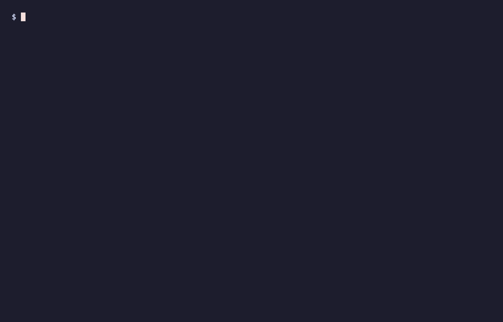
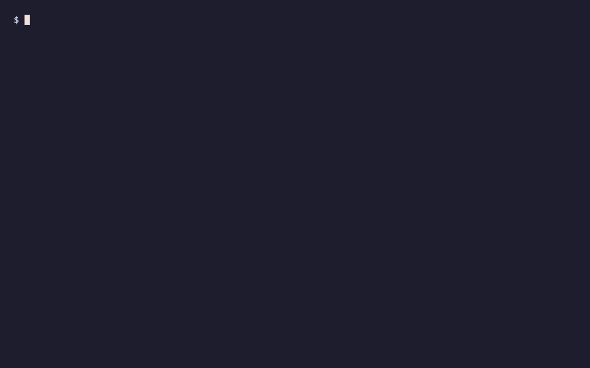
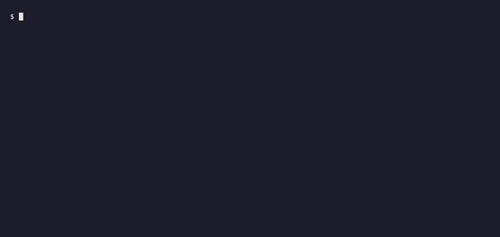
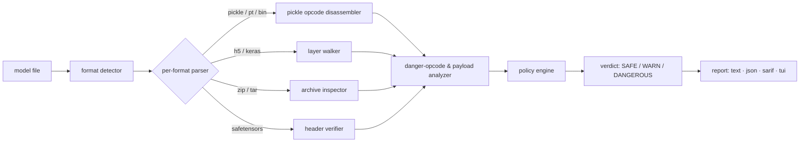

<div align="center">

# ⟁ byakugan &nbsp;白眼

### See the backdoor inside your model files — before you load them.

**`byakugan` is a static scanner for machine-learning model artifacts. It reads a model file the way the Byakugan reads the chakra network — straight through the serialized format to the exact points where loading the file would execute code.**

`.pt` · `.bin` · `.ckpt` · `.h5` · `.keras` · `.pkl` · `.onnx` · `.gguf` · `.safetensors`

   

</div>

> **Status: design preview.** This repository is a product-design artifact. The CLI, TUI, and output shown below are the *intended* experience; the scanning engine is being built. The recordings are rendered from a UX mock so we can design the tool from the operator's point of view first. Nothing here loads or executes a real model.

---

## Why

A model file is not just data. The most common ways to ship PyTorch and scikit-learn models — Python **pickle**, and pickle-backed `.pt` / `.bin` / `.ckpt` — are a serialization format that can carry **executable code**. The moment you call `torch.load(...)` or `pickle.load(...)`, a crafted file can run `os.system(...)`, open a socket, drop a payload, or exfiltrate credentials. No training, no inference, no "running the model" required — **deserialization is the exploit.** Keras `.h5`/`.keras` carry the same risk through `Lambda` layers, and `trust_remote_code=True` quietly executes attacker Python straight from a model repo.

People download these files by the millions from public hubs. "It's just weights" is how the backdoor gets in.

`byakugan` looks at the artifact **statically** — it parses the container and disassembles the pickle virtual machine without ever handing control to it — and tells you whether opening the file is safe, suspicious, or an outright code-execution trap.

> **The honest landscape.** This class of problem isn't new: [`fickling`](https://github.com/trailofbits/fickling) (Trail of Bits) and [`modelscan`](https://github.com/protectai/modelscan) (Protect AI) pioneered pickle/opcode analysis, and Hugging Face scans uploads. `byakugan`'s bet is on **developer experience and coverage**: one binary across every format, a readable "chakra network" opcode view that explains *why*, first-class policy (e.g. *safetensors-only*), SARIF + a GitHub Action for CI gating, and a shared engine with the rest of the **Armur** suite.

---

## What byakugan sees

| Category | Example tenketsu (danger point) | Rule family |
|---|---|---|
| **Code execution on load** | `GLOBAL posix system` + `REDUCE` → `os.system(...)` | `armur/pickle/reduce-*` |
| **Suspicious imports reachable** | `STACK_GLOBAL socket.socket`, `subprocess.Popen` | `armur/pickle/import-*` |
| **Keras Lambda code** | arbitrary Python serialized in a `Lambda` layer | `armur/keras/lambda-code` |
| **Remote-code auto-exec** | `trust_remote_code` hook referenced by config | `armur/config/remote-code` |
| **Opaque embedded blobs** | high-entropy non-tensor payload riding in the archive | `armur/blob/high-entropy` |
| **Format policy violation** | an unsafe-by-design format where policy requires `safetensors` | `armur/policy/require-format` |

### Format matrix

| Format | Extensions | Can carry code on load? | byakugan does |
|---|---|---|---|
| Python pickle | `.pkl` | **Yes — by design** | disassemble the pickle VM, flag dangerous opcodes |
| PyTorch | `.pt` `.bin` `.ckpt` | **Yes** (zip-wrapped pickle) | unpack archive → disassemble `data.pkl` |
| Keras / HDF5 | `.h5` `.keras` | **Yes** (`Lambda` layers) | walk layers, extract & flag embedded code |
| joblib / numpy | `.joblib` `.npy` `.npz` | **Yes** (pickle-backed) | detect pickle sub-streams |
| ONNX | `.onnx` | Limited (custom ops) | parse protobuf, flag custom/opaque operators |
| GGUF | `.gguf` | No (data) | parse header, sanity-check, flag parser abuse |
| **safetensors** | `.safetensors` | **No — safe by design** | verify header + confirm no code paths ✅ |

---

## Quick start

```sh
# install (design preview — coming soon)
brew install armur-ai/tap/byakugan
#   or
curl -fsSL https://get.armur.ai/byakugan | sh

# scan a single artifact
byakugan scan model.pt

# scan a directory, gate CI on anything dangerous, emit SARIF
byakugan scan ./models --sarif --fail-on dangerous > byakugan.sarif
```

### `byakugan scan` — the eye opens



It detects the container, unpacks the archive, disassembles the pickle VM, and reports every **tenketsu** — the exact offsets where loading the file would do something dangerous — ending in a single clear verdict.

### `byakugan inspect` — the chakra network



`inspect` shows the opcode stream itself, with the dangerous points marked (`◀ tenketsu`, `ACE` = arbitrary-code-execution), then reads back *in plain English* how the `GLOBAL` + `REDUCE` pair becomes `os.system(...)`. The clean `safetensors` path is shown for contrast — a format that simply cannot carry code.

### `byakugan tui` — the all-seeing viewer



A triage console: artifacts on the left with their verdicts, the selected file's chakra network on the right, and the exact dangerous call + remediation in the detail pane.

---

## Commands

| Command | What it does |
|---|---|
| `byakugan scan <file\|dir>` | Static scan → findings table + verdict |
| `byakugan inspect <file>` | Opcode/layer disassembly with dangerous points highlighted |
| `byakugan verify <file>` | Confirm an artifact is in a safe-by-design format (green path) |
| `byakugan policy` | Show / check the active policy (`.byakugan.yml`) |
| `byakugan tui` | Interactive triage viewer |

Common flags: `--json`, `--sarif`, `--fail-on <safe\|warn\|dangerous>`, `--policy <file>`, `--deep` (opcode-level), `--quarantine` (move dangerous files aside).

---

## The verdict model

Two independent things are reported and only then fused into advice:

- **Reachable code** — does loading the file transfer control to code? (opcode-level)
- **Intent signals** — do the reachable calls / imports / blobs look hostile?

| Verdict | Meaning | Exit code |
|---|---|---|
| `SAFE` | No load-time code paths (or a safe-by-design format) | `0` |
| `WARN` | Reachable-but-ambiguous signals — a human should look | `2` |
| `DANGEROUS` | Confirmed code execution on load | `3` |

Exit `1` is reserved for a tool error, so CI can branch on the verdict precisely.

---

## Architecture



<details>
<summary>ASCII fallback</summary>

```
                          ┌─ pickle opcode disassembler ─┐
 model file ─▶ format ─▶  ├─ h5 / keras layer walker ────┤ ─▶ danger-opcode &
               detector   ├─ zip / tar archive inspector ┤    payload analyzer
                          └─ safetensors header verifier ┘            │
                                                                      ▼
   report  ◀── verdict (SAFE / WARN / DANGEROUS)  ◀──  policy engine ─┘
   text · json · sarif · tui
```
</details>

The pickle disassembler is the heart: it runs the pickle **opcodes through an interpreter that resolves symbols but never executes them**, so `GLOBAL`/`STACK_GLOBAL` + `REDUCE`/`INST`/`OBJ` sequences are identified as the callables they would invoke — without invoking them.

---

## The one blind spot

The Byakugan famously has a single blind spot — and so does this one, on purpose.

`byakugan` finds **load-time / serialization backdoors in the artifact**: code that runs when you open the file. It does **not** detect **weight-space trojans** — "sleeper agent" models trained so a hidden trigger flips their behavior (emit exploitable code, bypass a guardrail). Those backdoors live in the *numbers*, produce no dangerous opcode, and cannot be found by static inspection; detecting them is a behavioral, probing problem and remains an open research frontier.

We say this plainly rather than overclaim. The honest complement is **behavioral detection** — running the model and watching what it does — which is a different tool with a different engine (see the behavioral/immune-style work elsewhere in the Armur suite). `byakugan` guards the *file*; something else has to guard the *behavior*.

---

## CI / GitHub Action

```yaml
# .github/workflows/model-scan.yml
name: model-scan
on: [push, pull_request]
jobs:
  byakugan:
    runs-on: ubuntu-latest
    steps:
      - uses: actions/checkout@v4
      - uses: armur-ai/byakugan-action@v1
        with:
          path: models/
          fail-on: dangerous      # fail the build on code-exec artifacts
          policy: .byakugan.yml    # e.g. require-format: safetensors
          sarif: true              # upload to GitHub code scanning
```

Findings land in the **Security → Code scanning** tab via SARIF, so a backdoored checkpoint shows up as a reviewable alert on the PR that introduced it.

---

## Roadmap

- [ ] Pickle VM disassembler across protocols 0–5 (the core)
- [ ] PyTorch zip + legacy tar archive unpacking
- [ ] Keras `.h5` / `.keras` Lambda extraction
- [ ] safetensors / GGUF / ONNX verifiers
- [ ] Policy engine (`require-format`, `forbid`, `allow-from`) + `.byakugan.yml`
- [ ] SARIF output + GitHub Action
- [ ] The `tui` triage viewer
- [ ] Hugging Face Hub pre-download scanning (`byakugan scan hf://org/model`)

---

## Contributing

byakugan is part of the **Armur** open-source security suite. Issues and PRs welcome once the engine lands; for now, the most useful contribution is a real-world backdoored-artifact sample (safely!) or a format we haven't covered. See `CONTRIBUTING.md` *(coming soon)*.

## License

Apache-2.0 *(intended)*.

<div align="center"><sub>⟁ byakugan — part of the Armur security suite. The eye that sees the backdoor before you load it.</sub></div>
